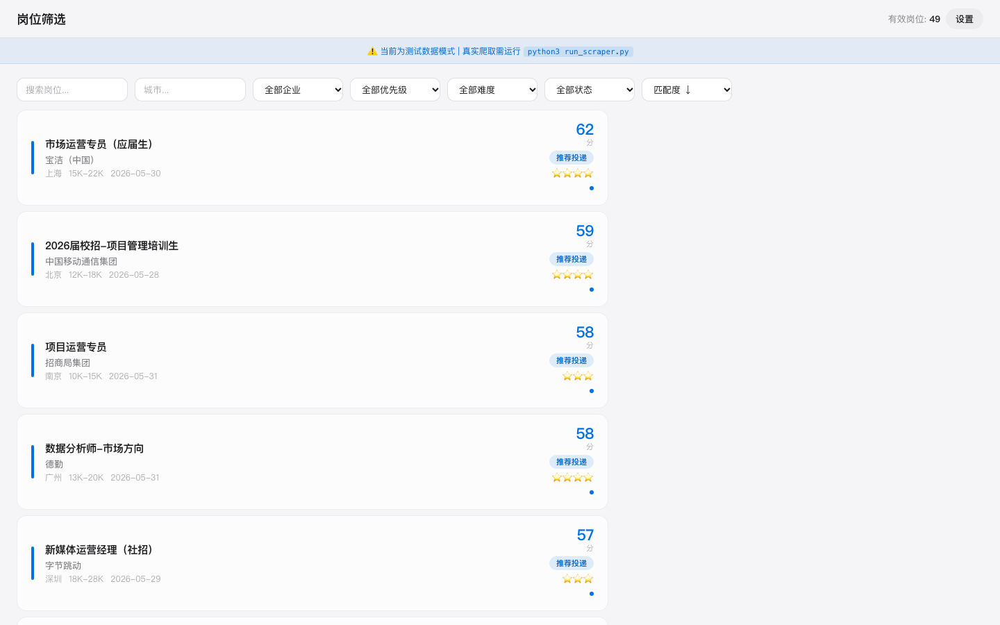

# 岗位信息智能筛查系统（gangwei-screener）

面向求职场景的自研 Web 应用：把「人工刷招聘网站筛岗位」的数小时压缩到分钟级。



## 功能模块

| 模块 | 说明 |
|------|------|
| 简历解析 | 上传简历 PDF，自动提取教育背景、技能、求职意向与行业经验，构建用户画像（PyMuPDF + 规则 + jieba） |
| JD 关键词匹配 | 岗位标题 / 描述与用户画像做关键词与倒排索引匹配，输出匹配得分 |
| 岗位优先级排序 | 按城市偏好、行业偏好、公司性质（央国企 / 外企 / 民企）、岗位类型等规则综合评分排序 |

## 数据来源

爬虫层（requests / Playwright 双通道）覆盖 6 大招聘平台：国聘、24365 校园招聘、拉勾、猎聘、牛客、应届生网。

## 技术栈

- Python 3 / Flask / SQLite
- PyMuPDF（简历解析）、jieba（分词）、BeautifulSoup + lxml + Playwright（采集）
- 前后端同仓：原生 HTML/CSS/JS + REST API

## 快速开始

```bash
pip install -r requirements.txt
# 将你自己的简历 PDF 放入 resume/ 目录
python app.py
# 打开 http://localhost:5050
```

首次运行自动建库；可用 `python inject_test_data.py` 注入演示数据体验完整流程。

## 项目结构

```
analyzer/   简历解析、岗位匹配、优先级排序
scraper/    6 大平台采集器（base + 各平台实现 + manager 调度）
web/        Flask 路由 + 模板 + 静态资源
storage/    SQLite 数据层（models / database）
data/       运行时数据库（不入库）
```

## 设计思路

最初的需求很模糊：「帮我筛岗位」。拆解后变成三条可执行规则：

1. **先懂我** —— 简历解析生成结构化画像；
2. **再懂岗位** —— 标题/描述与画像的匹配打分；
3. **最后排序** —— 把「想去哪、想干什么、什么公司」变成可配置的优先级规则。

配置集中在 `config.yaml`，规则和权重可随时调整。
